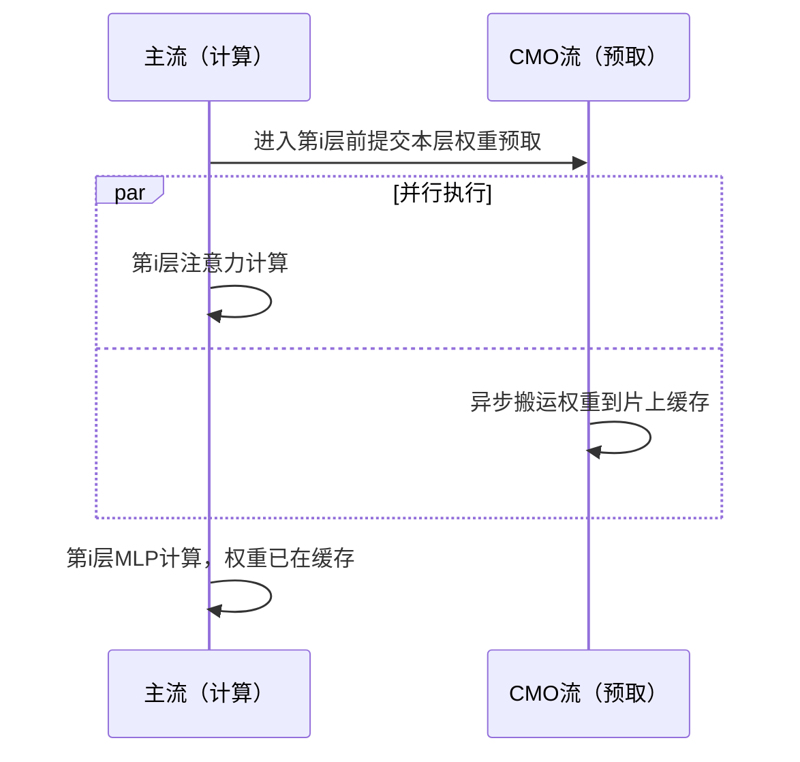

# Alpamayo-R1 昇腾 NPU 推理优化说明

本文介绍 Alpamayo-R1（下文简称 AR-1）在昇腾NPU上的迁移与性能优化方法。第 1 至 5 节是单算子替换与内存优化；第 6 至 8 节介绍图模式接入、权重预取与 Cholesky 求解的 NPU 原生实现；第 9 节给出 A2、A3 两个平台的性能与精度数据；第 10 节为复跑方法；第 11 节列出已知限制。

## 1. Flash Attention (FA) 替换

### 优化说明
本样例使用torch_npu内置的npu_fusion_attention融合算子替换源代码中的小算子实现，npu_fusion_attention详细可见[Ascend社区文档](https://www.hiascend.com/document/detail/zh/Pytorch/710/apiref/torchnpuCustomsapi/context/torch_npu-npu_fusion_attention.md)。

### 实现方式
在模型配置中设置以下参数，会调用torch_npu内置的npu_fusion_attention融合算子：

```python
config.attn_implementation = 'flash_attention_2'
```

### 优化位置
- 文件：`src/alpamayo_r1/models/base_model.py`
- 修改：在模型初始化时设置attention实现方式

---

## 2. Transformers库中布尔索引优化

### 优化说明
原始实现中使用了布尔索引操作，效率较低。通过优化索引计算逻辑，避免不必要的布尔运算和类型转换。

### 实现方式

**原始实现：**
```python
if image_features is not None and inputs_embeds[special_image_mask].numel() != image_features.numel():
```

**优化后实现：**
创建了独立的`patched_get_placeholder_mask`函数，优化了image和video token的mask生成逻辑：
```python
if image_features is not None:
    n_masked_elements = special_image_mask.sum().item()
    if n_masked_elements != image_features.numel():
        raise ValueError(
            f"Image features and image tokens do not match: tokens: {n_image_tokens}, features {image_features.shape[0]}"
        )
```

### 优化位置
- 新增文件：`src/alpamayo_r1/qwen_patches/qwen3vl_optimization.py`
- 新增：`patched_get_placeholder_mask`函数
- 新增：`apply_qwen3vl_patches()`函数用于应用patch

---

## 3. RmsNorm算子优化

### 优化说明
本样例使用torch_npu内置的npu_rms_norm融合算子替换源代码中的小算子实现，npu_rms_norm详细可见[Ascend社区文档](https://www.hiascend.com/document/detail/zh/Pytorch/710/apiref/torchnpuCustomsapi/context/%EF%BC%88beta%EF%BC%89torch_npu-npu_rms_norm.md)。在`src/alpamayo_r1/models/action_in_proj.py`的`RmsNorm`类中使能`npu_rms_norm`融合算子：

### 实现方式

**原始实现：**
```python
def _norm(self, x):
    """Normalize the input tensor."""
    return x * torch.rsqrt(x.pow(2).mean(-1, keepdim=True) + self.eps)

def forward(self, x):
    """Normalize the input tensor."""
    output = self._norm(x.float()).type_as(x)
    return output * self.weight
```

**优化后实现：**
```python
def forward(self, x):
    input_dtype = x.dtype
    weight_dtype = self.weight.dtype

    if input_dtype != weight_dtype:
        weight_dtype = self.weight.to(input_dtype)
    else:
        weight = self.weight

    # npu_rms_norm returns
    output = torch_npu.npu_rms_norm(x, weight, self.eps)[0]
    return output
```

### 优化位置
- 文件：`src/alpamayo_r1/models/action_in_proj.py`
- 类：`RmsNorm`
- 修改：使用`torch_npu.npu_rms_norm`替换原始实现

---

## 4. ADD算子优化：使用融合算子torch.addcmul

### 优化说明
在扩散模型的积分过程中遇到了`x = x + dt * v`这样的操作。使用昇腾NPU提供的融合算子`torch.addcmul`，可以将加法和乘法融合为一个算子，减少计算步骤和内存访问。

### 实现方式

**原始实现：**
```python
x = x + dt * v
```

**优化后实现：**
```python
x = torch.addcmul(x, dt, v)
```

### 优化位置
- 文件：`src/alpamayo_r1/diffusion/flow_matching.py`
- 函数：`flow_matching_euler`积分步进
- 修改：使用`torch.addcmul`替换原始的加法和乘法组合

---

## 5. Concat优化：预分配+索引赋值

### 优化说明
在处理多特征拼接时，原始实现使用`torch.cat`进行多次拼接，这会导致多次内存分配和数据拷贝。优化方案是预先分配完整大小的tensor，然后通过索引直接赋值，避免拼接操作。

### 实现方式

**原始实现：**
```python
action_feats = torch.cat([s(x[:, :, i]) for i, s in enumerate(self.sinus)], dim=-1)
timestep_feats = self.timestep_fourier_encoder(timesteps[..., -1])
timestep_feats = timestep_feats.repeat(1, T, 1)
x = torch.cat((action_feats, timestep_feats), dim=-1)
```

**优化后实现：**
```python
batch_feats = torch.empty(B, T, self.num_input_feats, device=x.device, dtype=x.dtype)
offset = 0
for i, s in enumerate(self.sinus):
    feat = s(x[:, :, i])
    batch_feats[:, :, offset:offset+feat.size(-1)] = feat
    offset += feat.size(-1)
timestep_feats = self.timestep_fourier_encoder(timesteps[..., -1])
batch_feats[:, :, offset:] = timestep_feats.repeat(1, T, 1)
x = batch_feats
```

### 优化位置
- 文件：`src/alpamayo_r1/models/action_in_proj.py`
- 类：`PerWaypointActionInProjV2`
- 方法：`forward`
- 修改：预分配`batch_feats`，使用索引赋值替代`torch.cat`

---

## 6. 图模式接入（enable_graph，默认关闭）

扩散采样固定跑 10 步，每一步的输入形状相同，逐算子下发的主机侧开销在这一段被放大。图模式把这一段整体捕获下来，之后每次请求直接回放。

### 6.1 捕获对象选择


VLM 自回归生成这一段（`vlm.generate`）的输出长度随输入变化。要整段入图，得先按预设的最大序列长度把形状固定下来，尾部会多出无效计算，本方案没有采用。轨迹 token 的融合与后处理计算量小，捕获收益有限。扩散采样（`diffusion.sample`）固定执行 10 步 Euler 积分，每一步调用 `step_fn(x, t)`，输入形状完全静态，也没有与数据相关的分支，因此选它作为捕获对象。

### 6.2 算子入图能力

捕获期间所有算子都要跑在捕获流上，捕获结束时运行时会检查这一条件。我们在 910B3（CANN 9.1.0 + torch_npu 2.8.0，默认配置）上按「每个用例单独进程」逐个测试：

| 用例 | relaxed | global |
|---|---|---|
| `matmul`（纯 torch 原语） | 捕获并回放正常 | 捕获并回放正常 |
| `torch_npu.npu_rms_norm` | 捕获并回放正常 | 捕获并回放正常 |
| `npu_fusion_attention`（BNSD，seq 128） | 失败，107025 | 失败，107025 |
| `npu_fusion_attention`（BNSD，seq 1024） | 失败，107025 | 失败，107025 |
| `npu_fusion_attention`（BSH） | 失败，107025 | 失败，107025 |
| `scaled_dot_product_attention` | 失败，107025 | 失败，107025 |

注意力类算子的失败发生在捕获结束时，不在捕获过程中：

```
NPU function error: c10_npu::acl::AclmdlRICaptureEnd(capture_stream_, &model_ri), error code is 107025
EE9999: The type of the task is not event record nor capture record
```

107025 是 ACL 运行时返回的错误码，torch_npu 在捕获结束时把它透传上来，不是 PyTorch 层的异常。ACL 给出的原因是捕获结束时流上出现了既不是 event record 也不是 capture record 的任务，也就是算子内部派生了没有汇入捕获流的操作。

该操作可以通过 `sync=True` 收敛到捕获流：实测 `npu_fusion_attention(..., sync=True)` 能在捕获区间内正常 capture 与 replay；默认的异步形式在 `capture_end` 报 107025，`capture_error_mode` 取 `thread_local`、`relaxed` 或 `auto_dispatch_capture=True` 都不能绕过。本样例仍把轨迹专家的注意力换成即时执行实现，原因是捕获与不捕获走同一条注意力代码路径、输出与上游逐位一致，也不依赖 `sync` 语义；融合算子入图的端到端收益未在 A2/A3 上量化。

处理办法是把轨迹专家的注意力换成 transformers 的即时执行实现，即 matmul 加 softmax。上游在这里传的是带 padding 的 additive mask，会把 prefill 中 `<traj_future_start>` 之后的位置屏蔽掉；本样例改为传入全零 mask，整段 prefill 可见，实测该被屏蔽区间只有 0 到 26 个 token，两种写法在 5 个 clip 上逐个 minADE 相同。全零 mask 已经表达了「所有位置可见」这一语义，因此即时执行路径不再额外传 `is_causal`。轨迹专家的注意力实现由 `AR1_EXPERT_ATTN` 指定，默认 `eager`；设为 `flash_attention_2` 仅用于对照，本环境下该路径会在 `npu_fusion_attention` 上报参数转型错误，不建议启用。开图与不开图使用同一份实现、同一个 mask，输出逐位一致。`npu_rms_norm` 也换成等价的纯 torch 写法，原因相同。

### 6.3 图对象生命周期

图对象由 `graph_runner.GraphStepRunner` 管理：

1. 在图外准备静态输入 buffer、输出 buffer 和可复用的 workspace，每一步把 x 与 t 拷贝进静态 buffer。
2. 在侧流上预热 2 次，再调用 `torch.npu.graph` 完成捕获。
3. 捕获失败时自动回到不开图的路径，结果不变。
4. `enable_graph=False` 时完全走原路径，不创建图对象。

设置 `AR1_GRAPH_DEBUG=1` 可以打印捕获与回放阶段的耗时。接入方式如下，`step_fn` 是扩散采样中形状固定的那一步：

```python
from alpamayo_r1.graph_runner import wrap_step_fn

# runners 按“批大小、分桶”缓存图对象，挂在模型实例上
step_fn = wrap_step_fn(step_fn, enable=True, cache=runners, key=(batch_size, bucket))
```

随机数在图外处理：扩散的初始噪声在 `diffusion/flow_matching.py` 的 `sample()` 入口一次性采样，捕获区内只有 10 步确定性的 `step_fn`，不含随机数生成。每次请求前调用 `torch.npu.manual_seed_all(42)`，结果可复现。

### 6.4 视觉塔位置编码缓存

`Qwen3VLVisionModel.forward` 每次请求都会调用 `fast_pos_embed_interpolate(grid_thw)` 和 `rot_pos_emb(grid_thw)`，计算网格插值位置编码与三维旋转位置编码。这两个结果只取决于图像的网格形状 `grid_thw`，分辨率固定时每次算出的一样，重复计算没有收益。实测单次请求中这部分冷算约 43 ms，并随图像数量线性增长。

`vision_cache.VisionMetadataCache` 以「方法名、`grid_thw`、数据类型、设备」为键缓存这两个结果，网格形状变化时才重算，缓存上限 8 条。视觉塔对它们都是只读使用，一个用于 `hidden_states + pos_embeds`，另一个用于拼成 cos 与 sin，直接返回缓存张量是安全的。

冷算、未命中、命中三条路径的输出完全相同；整次推理也做过对照，未开启与图模式得到的轨迹张量相同，最大差值为 0。缓存随图模式一起挂载，`AR1_VISION_CACHE=0` 可单独关闭它而保留图模式。A2 上单个公开 clip 测下来，未开启 9.00 s，图模式加缓存 8.15 s，下降 0.85 s。

### 6.5 静态 KV 复用

`prompt_cache` 由 `vlm.generate` 每次推理新建，地址每次都不同。图对象若直接引用它，捕获只在当次有效；若每次重新捕获，预热两次加捕获约 0.7 s，开图反而更慢。

解决办法是把轨迹专家的输入形状用分桶固定下来：

- `StaticCache` 一次性分配完整的键值 buffer，`update` 始终返回长度等于 `max_cache_len` 的键和值，注意力形状恒定。
- 桶大小取 `ceil((prefill+64)/1024)×1024`，最小 2048；按「批大小、桶大小」把状态缓存在模型实例上。
- 每次推理把 VLM `prompt_cache` 的 prefill 键值拷进静态 buffer，尾部置零并用负无穷 mask 屏蔽，语义与按实际长度分配一致。
- 显式传入 `cache_position`，位置由本侧管理；同时包装 `StaticLayer.update`，对写入的键值做数据类型对齐。轨迹专家经 k_norm 与 rope 后是 float32，与动态路径 `cat` 时的隐式提升等价。
- 图对象同样按「批大小、桶大小」缓存，每个进程每个桶只捕获一次，后续直接回放。
- 不开图与开图共用这条静态路径，同一 buffer、同一 mask、同一算子序列，两档输出完全一致。

设置 `AR1_STATIC_KV=0` 可回到按实际长度分配的路径。该路径默认开启，与图模式开关无关：不开图时同样走静态 KV，这样两种模式共用一条算子序列。

### 6.6 优化位置

- 文件：`src/alpamayo_r1/models/alpamayo_r1.py`，方法 `sample_trajectories_from_data_with_vlm_rollout`
- 文件：`src/alpamayo_r1/models/action_in_proj.py`，类 `RMSNorm`
- 新增模块：`src/alpamayo_r1/graph_runner.py`、`src/alpamayo_r1/static_kv.py`、`src/alpamayo_r1/vision_cache.py`、`src/alpamayo_r1/flags.py`、`src/alpamayo_r1/npu_ext.py`

## 7. 权重预取（enable_prefetch，默认关闭）

### 7.1 优化原因

用 msprof 的 `--application` 模式采基线（aic-metrics 默认集）：单次推理 NPU 算子时间 6.65 s，其中 `MatMulV3` 占 1.92 s（29%，平均每次 5.6 ms），主要是权重读取密集的 prefill 与 decode 投影；`FlashAttentionScore` 占 0.84 s。VLM 在 decode 阶段每生成一个 token 都要读一遍各层权重（10B、bf16），这部分是主要访存流量，属于访存受限的热点。

### 7.2 实现方式

`prefetch.CmoWeightPrefetcher` 在解码层的 `forward_pre_hook` 里，于独立的 CMO 流上对本层 MLP 的 `down_proj` 权重提交预取。CMO 是昇腾的缓存维护指令，可以把权重提前搬进片上缓存。提交不设依赖，异步执行，权重搬运与本层注意力计算重叠。权重是静态参数，不存在数据依赖，这样安排是安全的。

预取器在 `vlm.generate` 调用之前挂上钩子、返回之后摘除，作用范围正好覆盖 VLM 自回归解码这一段，也就是 7.1 节定位的访存热点。扩散采样阶段运行的是轨迹专家，不在预取范围内。

```python
# self.stream 是独立的 CMO 流，weight 是本层 down_proj 的权重
with torch.npu.stream(self.stream):
    torch_npu.npu_prefetch(weight, None, nbytes)
```

主流与 CMO 流的关系：



预取的三条约束：

- 单次预取字节上限由 `AR1_PREFETCH_MAX_MB` 控制，默认 128 MiB。该值必须大于单层 `down_proj` 的体积（VLM 解码层为 4096×12288 个 bf16 参数，约 96 MiB）；上限偏小时提交会被跳过，`stats` 里只增 `skipped_size`。
- 默认只在前 `AR1_PREFETCH_LAYERS` 层注册，默认 1。实测 36 层全注册时每 token 提交一次，主机侧开销让组合档增加 0.17 s，因此收敛到首层。
- `npu_prefetch` 不存在、不在 NPU 上或提交异常时静默回退。`AR1_PREFETCH_IMPL=touch` 可切到基于侧流分段读取的备用实现。

### 7.3 生效验证

预取是否真实发生，由 `CmoWeightPrefetcher.stats` 判定。注册成功后，VLM 解码每生成一个 token、首层前向一次，钩子就调用一次 `submit`，`hooks` 与 `submitted` 同步增长、`skipped_size` 保持为 0。一次 20 个解码步的推理结束后，`stats` 为 `hooks=20`、`submitted=20`、`skipped_size=0`、`skipped_api=0`、`errors=0`：

```python
layers = list(model.vlm.model.language_model.layers)
prefetcher = build_prefetcher(layers).attach()
# ... 一次推理之后
print(prefetcher.stats)   # hooks 与 submitted 同步增长，skipped_size 为 0
prefetcher.detach()
```

单次预取体积超过 `AR1_PREFETCH_MAX_MB` 时提交被跳过，表现为 `skipped_size` 增长而 `submitted` 不变；`npu_prefetch` 接口缺失计入 `skipped_api`，提交异常计入 `errors`。这三种情况都只是不预取，不改变推理结果。

预取走独立的 CMO 流，与主流是两个不同的 `Stream` 对象，提交不设 dependency、也不插入同步，因此搬运与本层计算重叠。多流时间线的 profiler 采集未做，重叠比例未量化；端到端耗时的影响同样未量化，见 9.1 节。

### 7.4 优化位置

- 文件：`src/alpamayo_r1/models/alpamayo_r1.py`，`vlm.generate` 调用前后挂载与摘除钩子
- 新增模块：`src/alpamayo_r1/prefetch.py`

## 8. Cholesky 分解改用 NPU 原生实现

### 优化说明

`action_space/utils.py` 的轨迹平滑最小二乘求解原本用 `torch.linalg.cholesky` 加 `torch.cholesky_solve`，涉及 `solve_xs_eq_y`、`dxy_theta_to_v*` 等 4 处。NPU 不支持这两个接口，每次调用都回退到 CPU，并产生主机与设备之间的同步。

### 实现方式

改为纯 torch 实现的批量 Cholesky，按列处理的向量化写法，与 libblas 的分解算法相同，全部跑在 NPU 上，不再有主机同步。实测不开图时端到端从 7.954 s 降到 7.894 s，同一次会话内对比，minADE 不变。设置 `AR1_LEGACY_OPS=1` 可回到原来基于 CPU 的实现。

### 优化位置

- 文件：`src/alpamayo_r1/action_space/utils.py`
- 新增函数：`cholesky_solve_torch`
- 修改：`solve_xs_eq_y`、`dxy_theta_to_v*` 等 4 处调用点改为调用该函数

## 9. 性能与精度结果

以下数据采集于 Atlas 800T A2（910B3）与 Atlas A3（Ascend910_9382），CANN 9.1.0、torch 2.8.0、torch_npu 2.8.0，固定随机种子，采集期间无并发负载。

### 9.1 端到端耗时

每种配置预热 1 次、正式跑 3 次，另各跑 20 次取稳态。计时覆盖 `sample_trajectories_from_data_with_vlm_rollout` 整段，含 VLM 生成与扩散采样。

| 配置 | A2 3 次 | A2 20 次 | A3 3 次 | A3 20 次 |
|---|---|---|---|---|
| 未开启 | 8.063 s | 7.877 s | 6.810 s | 6.790 s |
| 图模式 | 7.582 s | **7.493 s** | 6.520 s | **6.525 s** |

视觉塔位置编码缓存随图模式一起生效，因此图模式一档的收益包含这部分；静态 KV 默认开启，两档都走该路径。权重预取对端到端耗时的影响未量化，见 7.3 节。

A2 20 次逐次值：未开启 8.15、7.82、7.81、7.82、7.85、7.91、7.83、7.88、7.83、7.88、7.92、7.81、7.83、7.86、7.88、7.88、7.93、7.92、7.88、7.86；图模式 8.02、7.49、7.46、7.48、7.51、7.49、7.41、7.47、7.47、7.47、7.48、7.45、7.43、7.45、7.47、7.44、7.46、7.48、7.47、7.47（首个值含首次捕获）。

A3 20 次逐次值：未开启 6.98、6.78、6.79、6.99、6.79、6.80、6.79、6.79、6.80、6.79、6.79、6.79、6.78、6.79、6.78、6.80、6.78、6.79、6.78、6.78；图模式 7.02、6.52、6.52、6.53、6.53、6.53、6.54、6.52、6.52、6.53、6.52、6.53、6.53、6.52、6.52、6.52、6.52、6.53、6.53、6.52（首个值含首次捕获）。

A3 三次迭代：未开启 6.96、6.78、6.81，图模式 6.96、6.51、6.52，首个值均含首次捕获。

上表不含 `bench/eval_minade.py` 中每个 clip 的数据集加载与图像预处理时间，这部分与优化项无关。

### 9.2 精度

| 平台 | mean minADE（100 clips，10 轨迹） | 环境 |
|---|---|---|
| A2 910B3 | 0.4828 | CANN 9.1.0 V100R001C11SPC001B243，torch 2.8.0 + torch_npu 2.8.0 |
| A3 Ascend910_9382 | 0.4954 | 同上 |
| 门槛 | ≤0.5676 | — |

评测口径与官方一致：数据集 `Physical-AI-AV` 的 `chunk_0000` 对应 `get_clip_chunk()` 返回的 chunk id 3116，共 100 个 clip（文件名即 `*.chunk_3116.zip`），revision 25.10；注意力用即时执行实现，t0 取 5.1 s，10 条轨迹，top_p 0.98、temperature 0.6、seed 42、bf16；每条 clip 取最小值后对 100 个 clip 求均值。

t0 的处理：`bench/eval_minade.py` 默认全部 clip 用 5.1 s，与仓内样例一致。要按数据集每个 clip 的 `event_start_timestamp` 取值，用 `--ood-parquet` 指定 `reasoning/ood_reasoning.parquet` 路径。这 100 个 clip 在该表中都没有记录，两种取法在 A2 上得到的均值同为 0.4828。

数值透明的两组对照：把轨迹专家的注意力从即时执行换成 `flash_attention_2`，7 个重叠 clip 逐个比对结果一致；设置 `AR1_LEGACY_OPS=1` 关掉算子替换（回到 `npu_rms_norm` 与 CPU Cholesky），前 20 个 clip 的 minADE 逐个相同、差值为 0。可以确认图模式、静态 KV、位置编码缓存与算子替换都不改变模型数值。

### 9.3 不同轨迹数

同一批 100 个 clip，`--num-traj 1/3/5/10` 逐一实测：

| 预测轨迹数 | A2 910B3 | A3 | 仓内样例 README |
|---|---|---|---|
| 1 | 1.7244 | 1.6155 | 2.2026 |
| 3 | 0.9314 | 0.9371 | 0.9498 |
| 5 | 0.7556 | 0.7712 | 0.8514 |
| 10 | 0.4828 | 0.4954 | 0.5676（门槛） |

3 轨迹时两个平台与仓内样例相差 1% 到 2%，5 轨迹优于样例值，说明 chunk 与 t0 的取法已对齐；10 轨迹低于门槛。

### 9.5 显存与稳定性

首次捕获 0.40 s（`AR1_GRAPH_DEBUG=1` 时日志输出 `[ar1-graph] capture ok in 0.40s`），每个进程每个桶只捕获一次，稳态回放不再编译。

显存用 `torch_npu.profiler` 采集（`profile_memory=True`，含 CPU activities，ProfilerLevel Level0），A2 与 A3 结果一致：

| 配置 | allocated | reserved | 峰值 allocated |
|---|---|---|---|
| 未开启 | 26.42 GiB | 39.47 GiB | 35.15 GiB |
| 图模式 | 26.68 GiB | 40.21 GiB | 35.41 GiB |

图模式多出的 0.26 GiB 来自静态 KV 的固定 buffer 与捕获后的图对象，不随请求数增长。


### 9.5 算子统计

采集命令 `msprof --output=<输出目录> --application=<被采样脚本> --ai-core=on`，被采样应用为 `bench/ablation.py`（`--iters 1`，即预热 1 次加正式 1 次，共 2 次推理），算子级数据取 `mindstudio_profiler_output/op_statistic.csv`。该表含采集开销，只用于看目标模块占比与算子是否变化。

| 配置 | NPU 算子总耗时 | MatMulV3 | 占比 | FlashAttentionScore |
|---|---|---|---|---|
| 未开启 | 13.937 s | 4.211 s | 30.2% | 1.409 s |
| 图模式 | 14.059 s | 4.208 s | 29.9% | 1.408 s |

两档的算子种类完全相同，均为 84 种，没有新增或消失；MatMulV3 从 4.211 s 到 4.208 s，FlashAttentionScore 从 1.409 s 到 1.406 s。本方案不改计算算子，只改两件事：一是下发方式，扩散 10 步由一次图回放替代逐算子下发；二是访存调度，在 VLM 解码每层计算前于独立 CMO 流异步提交权重预取。这与 9.2 节的精度结论相互印证。图模式下小算子调用次数略增（MatMulV2 15748→16004、Transpose 11203→11567、Mul 32026→32515，来自图捕获与静态 KV 路径），耗时占比合计低于 1%，算子总耗时差异 0.6%，不构成回退。

### 9.6 复现所需的信息

- 权重 `nvidia/Alpamayo-R1-10B`，revision `dd4a24cacefc9a6477a6dfc7354de2443401409d`。5 个分片 sha256：`6aabd8d143cff0295a60b515dfcb5ba6a5b1b5acf7cea1d6c6254ed653d35965`、`e346fcf2bf4ebd75853bd17b5744c4158cf621aba195aad7c7e2f1e484c1ae20`、`7acad9950402f002825aa41048155ea1a8a2fb5f7a00501154d52828291171c9`、`59f3ec7a6983ae2654b7ffe5d79f59d3d523b8a71a0ffc83362816886636ac0a`、`5753b1fd57638b70db4882cc8061eedfa28c2748a37414eb4032e20b1bb2e4c1`，可用 `sha256sum` 校验。
- 数据集 `nvidia/PhysicalAI-Autonomous-Vehicles`，revision 25.10，对应 commit `2ae73f49ffd2b5db43b404201beb7b92889f7afc`；`clip_index.parquet` 的 sha256 以 `9630a3de` 开头，`sensor_presence.parquet` 以 `967b6200` 开头。
- 输入集合为 chunk id 3116 的 100 个 clip，排序后 sha256 `b1b02342d708d796beb550a7277956e3263a47b2d00e4aa508d8024fad87a49b`，完整清单可用 `bench/eval_minade.py` 按同一 chunk 生成后比对。
- 上游改动在本仓 `navigation/alpamayo-r1/patches/graph-prefetch.patch`；本例新增的运行时模块在 `navigation/alpamayo-r1/src/alpamayo_r1/`，评测与自验脚本在 `navigation/alpamayo-r1/bench/`。

## 10. 复现命令

```bash
source /usr/local/Ascend/ascend-toolkit/set_env.sh
source ar1_venv/bin/activate
export HF_ENDPOINT=https://hf-mirror.com
export HF_TOKEN=<gated 数据集 token>   # eval_minade.py 需要

# 四档消融（两个开关默认关闭，按需分别打开）
python bench/ablation.py --model-path model_ckpt --iters 3
python bench/ablation.py --model-path model_ckpt --iters 3 --graph
python bench/ablation.py --model-path model_ckpt --iters 3 --prefetch
python bench/ablation.py --model-path model_ckpt --iters 3 --graph --prefetch

# 100 clips minADE（chunk_0000 为 chunk id 3116）
python bench/eval_minade.py --model-path model_ckpt --clips 100 --graph --prefetch --tag a2
```


## 11. 适用限制

- 图模式要求捕获区间内的算子都在捕获流上执行。实测 `npu_rms_norm` 可捕获并回放；默认异步形式的 `npu_fusion_attention` 在捕获结束时返回 107025，ACL 判定流上存在未汇入捕获流的任务，改用 `sync=True` 后可以捕获。样例按默认配置运行，轨迹专家的注意力用即时执行实现替代，该替代数学等价，输出与原来完全一致。
- 两个平台均达成优化目标：A2 稳态从 7.877 s 降到 7.493 s（4.9%），A3 从 6.790 s 降到 6.525 s（3.9%）。收益主要来自位置编码缓存，`rot_pos_emb` 与 `fast_pos_embed_interpolate` 只与网格形状有关，原实现每次请求都重算；扩散采样 10 步由图回放承载。
- 权重预取在 VLM 解码阶段提交，生效与否以 `CmoWeightPrefetcher.stats` 为准，端到端增益未量化，见 7.3 节。
- 精度方面，官方 chunk_0000 上 A2 为 0.4828、A3 为 0.4954，均低于门槛 0.5676；注意力实现与算子替换两组对照均完全一致，见 9.2 节。
- 静态 KV 默认开启、与图模式开关无关；视觉塔位置编码缓存随图模式一起生效。两者可分别用 `AR1_STATIC_KV=0`、`AR1_VISION_CACHE=0` 单独关闭。
- 权重与数据集不随代码入库，获取方式见样例 README。
